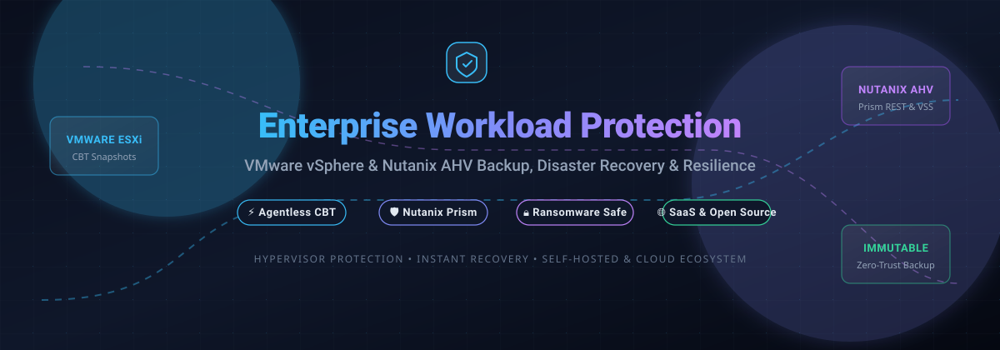

# 🛡️ Awesome Enterprise Workload Protection (VMware & Nutanix) 🚀

**Curated Directory of Enterprise SaaS Solutions & Open-Source Tools for Hypervisor Backup, VM Snapshotting, Immutable Storage & Disaster Recovery**  
*Covering VMware vSphere, ESXi, Nutanix AHV, and Alternative Modern Hypervisors* ⚡

---

## 📌 Executive Summary & Architecture Scope

This curated repository tracks the leading **enterprise SaaS platforms** and **open-source GitHub projects** for **Enterprise Workload Protection** across **VMware vSphere / ESXi** and **Nutanix AHV**. 

Modern virtualization disaster recovery requires more than simple VMDK file copies:
- ⚡ **Agentless CBT Backups:** Utilizing VMware Changed Block Tracking (CBT) and Nutanix Prism APIs for zero-impact, incremental-forever workload snapshots.
- 🔒 **Ransomware Cyber Resilience & Immutability:** S3 Object Lock, air-gapped repositories, and WORM-compliant immutable targets to guarantee unalterable restore points.
- 🔄 **Live Mount & Instant Recovery:** Instantly powering on VMs directly from deduplicated backup storage without waiting for multi-terabyte data transfers.
- 🌐 **Sovereignty & Multi-Hypervisor Portability:** Self-hosted open-source backup engines for organizations migrating between VMware, Nutanix AHV, Proxmox VE, and KubeVirt.

---

## 📑 Table of Contents
- [📊 Sector Overview & Market Dynamics](#-sector-overview--market-dynamics)
- [☁️ SaaS & Hosted Enterprise Platforms](#️-saas--hosted-enterprise-platforms)
- [💻 Open-Source GitHub Projects](#-open-source-github-projects)
- [🤝 How to Contribute](#-how-to-contribute)
- [💖 Support](#-support)
- [⚠️ Disclaimer](#️-disclaimer)
- [📈 Star History](#-star-history)

---

## 📊 Sector Overview & Market Dynamics

The enterprise backup and workload protection market is estimated at **$12B–$15B** globally (projected to exceed **$30B+ by the early 2030s** at an ~11% CAGR). The sector exhibits an oligopolistic, moderately concentrated core at the high-end enterprise tier—dominated by multibillion-dollar cyber resilience platforms (Veeam, Commvault, Rubrik, and Cohesity/Veritas)—yet remains fragmented at the perimeter and SMB edge where specialized point solutions compete to secure multi-cloud, container, and alternative hypervisor environments.

---

## ☁️ SaaS & Hosted Enterprise Platforms

| Product | Company Size (Valuation / Revenue) | Description | Starting Pricing | Free Tier / Trial Limits |
|---------|-----------------------------------|-------------|------------------|--------------------------|
| **[Rubrik](https://www.rubrik.com/)** | **~$22B–$25B Market Cap** ($1.54B TTM Rev) | **Native Nutanix AHV integration with Live Mount, Instant Recovery, and file recovery.** Documentation notes AHV recovery requires locally available snapshots (not from remote archives alone), and export operations always present disks as SCSI with CD-ROM as IDE—can fail to boot if guest OS lacks those drivers [citation:11]. | **$130/TB/month** (~$1,560/TB/year usable BETB capacity) | **30-day free trial** (SaaS workload protection evaluation with capacity caps) |
| **[Veeam Backup & Replication](https://www.veeam.com/)** | **~$15B Valuation** ($2.0B+ ARR) | **The market standard for VMware and Nutanix AHV protection.** Agentless image-level backup, instant VM recovery, and application-aware processing. Explicitly supports VMware vSphere, Nutanix AHV, Microsoft Hyper-V, Proxmox VE, and more [citation:1][citation:7][citation:12]. | **$120/workload/year** (VUL Universal License tier) | **Free forever (Community Edition)**: up to 10 workloads; full-featured evaluation trial for **30 days** |
| **[Cohesity](https://www.cohesity.com/)** | **~$7B–$9B Valuation** (~$1.5B Rev combined) | DataProtect with **Nutanix AHV support** (listed in NetBackup Backup Now workloads and supported platforms) [citation:14]. AI-powered threat detection and immutable snapshots. | **$150/TB/year** (front-end capacity tier) or $29,100/year base pack | **30-day free trial** (Cohesity DataProtect / Cloud Services BaaS) |
| **[Commvault Complete](https://www.commvault.com/)** | **~$7.2B Market Cap** ($1.25B TTM Rev) | **Enterprise data protection with IntelliSnap for Nutanix.** Supports Nutanix VMware IntelliSnap backups at the container level, requiring all VMs in a container to belong to one protection domain [citation:2]. Also supports Nutanix AHV via Virtual Server Snap Engine [citation:2]. | **$58.50/TB/month** (Commvault Cloud SaaS) or $1.70/user/month | **30-day free trial** (full evaluation access) |
| **[Veritas NetBackup](https://www.veritas.com/)** | **~$3B+ Enterprise Value** (~$1.4B Rev) | Enterprise backup with **Nutanix AHV support** (listed in Backup Now workloads) [citation:14]. Broad platform coverage including VMware vSphere. | **$300/TB/year** (NetBackup Flex capacity-based tier) | **30-day free trial** (standard evaluation license) |
| **[HYCU Protégé](https://www.hycu.com/)** | **~$350M–$500M Valuation** (~$30M+ ARR) | Multi-cloud data protection with Nutanix heritage (founded as a Nutanix-focused backup solution). | **$5,000/year** (HYCU Starter Bundle for SMBs) or $1.20/user/month | **14-day free trial** (full access for HYCU R-Cloud & cloud-native backup) |
| **[NAKIVO Backup & Replication](https://www.nakivo.com/)** | **~$30M Annual Revenue** (Bootstrapped/Private) | **Fast, reliable, and affordable protection for VMware vSphere, Microsoft Hyper-V, Nutanix AHV, and AWS EC2** [citation:10]. Positioned as a cost-effective alternative to enterprise suites. | **$2.45/workload/month** (billed annually, min. 5 workloads) | **Free Edition (1-year license)**: up to 10 workloads (VMs/servers); full trial for **15 days** |

---

## 💻 Open-Source GitHub Projects

Curated open-source projects for self-hosted hypervisor backups, CBT snapshotting, VM exports, and disaster recovery. Repositories are ranked by GitHub star count (descending):

| Open-Source Project | Stars | Focus & Hypervisor Support | License | Description |
|---|---|---|---|---|
| **[ghettoVCB](https://github.com/lamw/ghettoVCB)** |  | **VMware ESXi** | Community | **The defacto open-source ESXi backup tool.** Executes online, live VM snapshots and backup of VMDK disks directly on VMware ESXi hosts without requiring expensive licensing. |
| **[Bareos](https://github.com/bareos/bareos)** |  | **VMware vSphere, Proxmox, Hyper-V** | AGPLv3 | **Enterprise-grade backup suite with native hypervisor plugins.** Native VMware vSphere CBT plugin for agentless VM backup and instant file restore. Bareos 25 adds native Proxmox and Hyper-V plugins. |
| **[Xen Orchestra](https://github.com/vatesfr/xen-orchestra)** |  | **XCP-ng, Citrix Hypervisor** | AGPLv3 | Complete web management and backup engine for virtual machines, offering continuous delta backup, metadata archiving, and orchestrated disaster recovery. |
| **[ProxSave](https://github.com/tis24dev/proxsave)** |  | **Proxmox VE & PBS** | GPLv3 | Go-based open-source online configuration backup and disaster recovery tool for Proxmox VE hypervisor nodes and Proxmox Backup Server. |
| **[Proxmox Backup Server](https://github.com/proxmox/proxmox-backup)** |  | **Proxmox VE, Guest Workloads** | AGPLv3 | Enterprise backup server with chunk-level deduplication, incremental backups, and Zstandard compression. Protects VMware/Nutanix workloads via guest agents. |
| **[BackROLL](https://github.com/DIMSI-IS/BackROLL)** |  | **KVM / QEMU Hypervisors** | MIT | Containerized backup and restore tool for KVM guests. Leverages QEMU guest agents and hypervisor snapshotting with a clean web management console. |
| **[BackupZit](https://github.com/Max-Zit/backupzit)** |  | **VMware ESXi, Proxmox VE, Hyper-V** | AGPLv3 | Modern self-hosted backup console with agentless VMware ESXi changed block tracking proxies, NFS instant recovery, deduplication, and S3 immutable targets. |
| **[nutanix-backup](https://github.com/loginoff/nutanix-backup)** |  | **Nutanix AHV** | MIT | Python utility to snapshot Nutanix AHV VMs via Prism REST APIs, mount storage containers over NFS, and export raw disk images to external backup targets. |
| **[Transiva (Community Edition)](https://github.com/zyvorai/zyvor-transiva)** |  | **VMware vSphere & Nutanix AHV** | Apache-2.0 | Open-source hypervisor export and migration engine. Provides resumable, offline agentless VM export from vSphere and AHV for disaster conversion into KVM/KubeVirt. |

---

## 🤝 How to Contribute

1. 🍴 **Fork** the repository.
2. 🌿 Create a feature branch (`git checkout -b feature/new-workload-tool`).
3. 📝 Add or edit entries in `README.md` (keep descriptions objective and link to official documentation).
4. 🚀 Submit a **Pull Request** with a brief summary of additions.

Contributions covering new hypervisor tools, CBT plugins, and immutable storage backends are always welcome!

---

## 💖 Support

If you find this curated collection helpful for your virtualization and disaster recovery infrastructure, please consider supporting the project:

- ⭐ **Star this repository** to help others discover it.
- 🍴 **Fork and share** it with fellow sysadmins and DevOps engineers.
- ☕ **Buy me a coffee**: Sponsor continued maintenance and research via the [GitHub Sponsors Dashboard](https://github.com/sponsors/ishandutta2007).

Thank you for being part of the open workload protection community! 🙏

---

## ⚠️ Disclaimer

- This is a **community-curated** list — not exhaustive and not an official vendor endorsement.
- Workload protection platforms handle mission-critical production data. Enforce encryption at rest and in transit, store encryption keys off-site, and **test restores regularly**—a backup that cannot be restored is not a backup.
- **Nutanix AHV protection has platform-specific constraints.** Commvault requires all VMs in a container to belong to one protection domain for IntelliSnap [citation:2]. Rubrik notes that AHV recovery requires locally available snapshots and exports disks as SCSI with CD-ROM as IDE [citation:11].
- Validate hypervisor version compatibility, application consistency requirements, and restore SLAs before committing to an enterprise deployment.

---

## 📈 Star History

---

<b>Made with ❤️ for backup administrators, virtualization engineers, and site reliability teams.</b>

